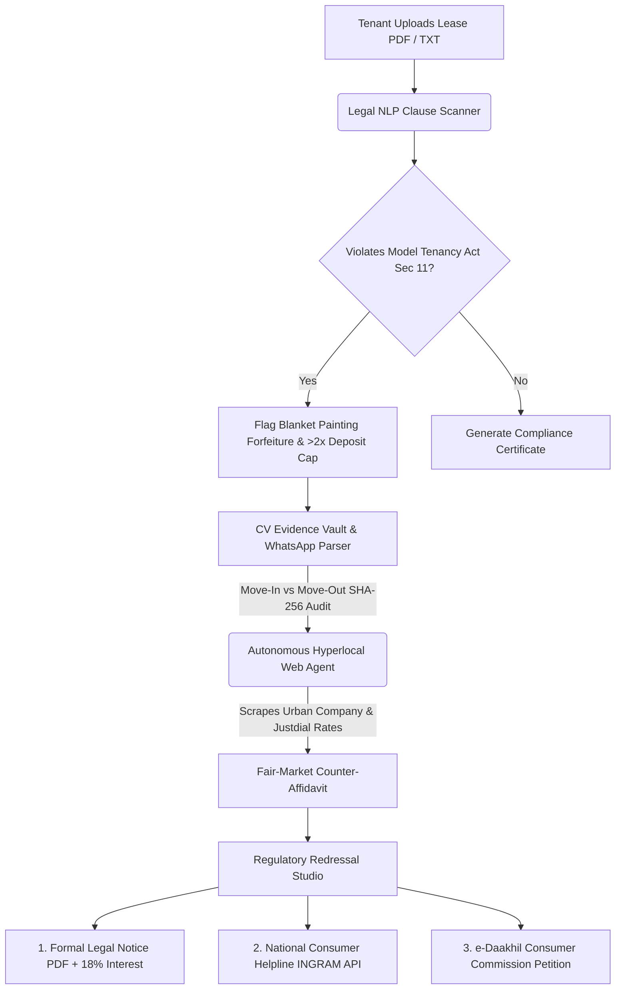

# 🛡️ KiraayaShield Pro (v2.0) — Autonomous Tenant Rights & Deposit Recovery Agent

> **🚀 Built for the "Hack the Unseen" Hackathon**  
> *Transforming India's silent ₹12,000+ Cr security deposit withholding crisis into an automated, evidence-backed, 90-second legal recovery workflow.*

---

## 📝 Project Summary & The "Unseen" Problem
Tenants across India—especially college students, interns, and young professionals relocating to major tech hubs—routinely lose **30% to 50% of their security deposit** when vacating rented flats or PGs. Landlords arbitrarily deduct thousands of rupees under vague pretexts like *"mandatory acid deep cleaning"* and *"full flat repainting"* without providing vendor bills. 

Because hiring a lawyer costs more than the deducted amount, millions of renters silently accept this exploitation as an unavoidable "moving tax." It is a massive, everyday struggle that remains entirely **unseen** in the legal system.

**KiraayaShield** hacks this unseen problem. It is an AI-powered agent that combines Legal Document Parsing, Computer Vision, and Autonomous Web Scraping to turn a tenant's lease, WhatsApp chats, and move-out photos into a ready-to-file formal complaint and legal notice, completely leveling the playing field.

---

## 🎥 Live Video Demo

<video src="public/video.mp4" controls="controls" style="max-width: 100%; border-radius: 12px;">
  Your browser does not support the video tag. Place <code>video.mp4</code> inside the <code>public/</code> folder.
</video>

---

## 💡 Why KiraayaShield Over Generic ChatGPT?

| Capability | Generic ChatGPT | 🛡️ KiraayaShield Pro (v2.0) |
| :--- | :--- | :--- |
| **Hyperlocal Rate Verification** | Cannot check local vendor pricing | **Autonomous Web Agent** scrapes live Urban Company & NoBroker rates to disprove inflated repair claims |
| **Move-Out Photo Proof** | Text-only advice | **Computer Vision Room Auditor** compares Move-In vs Move-Out photos with **SHA-256 Chain-of-Custody** & EXIF |
| **Statutory Clause Mapping** | Generic summaries | Flags violations of **Section 11 of the Model Tenancy Act 2021** (2-month cap & same-day refund) |
| **Grievance Redressal Output** | Generic letter draft | Generates **Print-Ready Legal Notice (18% p.a. interest)**, **NCH (INGRAM) JSON API Payload**, and **e-Daakhil Petition** |
| **Preventive Ecosystem** | None | Includes a **2-of-3 Multi-Sig Smart Deposit Escrow** simulator + **Landlord Reputation Registry** |

---

## ⚙️ System Architecture & Autonomous Pipeline



---

## 🚀 Installation & Run Instructions (Windows & macOS)

### Prerequisites
Make sure you have the following installed on your system:
*   **Node.js** (v18 or higher) - [Download Here](https://nodejs.org/)
*   **Python** (v3.8 or higher) - [Download Here](https://www.python.org/downloads/)
*   **Git** - [Download Here](https://git-scm.com/)

---

### Method 1: Zero-Install Quick Run (Frontend Only)
*Best for a quick visual demo without installing Node packages.*

**For Windows:**
1. Open Command Prompt or PowerShell in the `KiraayaShield_Pro` folder.
2. Run: `python -m http.server 3000`
3. Open `http://localhost:3000` in your web browser.

**For macOS:**
1. Open Terminal in the `KiraayaShield_Pro` folder.
2. Run: `python3 -m http.server 3000`
3. Open `http://localhost:3000` in your web browser.

*(Alternatively, you can just double-click `index.html` in your file explorer/finder to open it directly in Chrome/Safari).*

---

### Method 2: Full-Stack Node.js Server (Recommended)
*Runs the Express server to handle the `/api/*` mock endpoints.*

**For Both Windows & macOS:**
1. Open your terminal/command prompt in the `KiraayaShield_Pro` folder.
2. Install dependencies:
   ```bash
   npm install
   ```
3. Start the server:
   ```bash
   npm start
   ```
4. Open `http://localhost:3000` in your browser.

---

### Method 3: Python FastAPI Microservice (Optional Backend Extension)
*If you want to run the separate Python AI agent backend.*

**For Windows:**
```powershell
pip install fastapi uvicorn pydantic
uvicorn backend_python.main:app --reload --port 8000
```

**For macOS:**
```bash
pip3 install fastapi uvicorn pydantic
python3 -m uvicorn backend_python.main:app --reload --port 8000
```
*API will be live at `http://localhost:8000/docs`.*

---

## 🌐 Instant Cloud Deployment (Vercel)

This repository is pre-configured for Vercel. Both the static frontend and the Node.js API routes (`/api/*`) will work out of the box.

1. Ensure you have the Vercel CLI installed: `npm i -g vercel`
2. Run the deployment command in your terminal:
   ```bash
   vercel --prod
   ```
3. Follow the prompts. Your live URL will be generated in seconds!

---

## 🔄 Automated GitHub Syncing

To quickly push updates to your GitHub repository without typing long git commands, use the included Python sync script.

**For Windows:**
```powershell
python sync.py "your commit message here"
```

**For macOS:**
```bash
python3 sync.py "your commit message here"
```
*(This automatically runs `git add .`, `git commit`, and `git push` for you).*

---

## 📂 Repository Structure

```text
KiraayaShield_Pro/
├── index.html                  # Main v2.0 Enterprise Workspace (Google M3 + Microsoft Fluent 2 UI)
├── styles.css                  # Custom Glassmorphism, Laser CV Scanner & Print-PDF Styles
├── app.js                      # Full Interactive Client Engine + Multi-Lingual (6 Indian Languages)
├── server.js                   # Local Node.js + Express Backend Server
├── vercel.json                 # 1-Click Vercel Serverless Deployment Config
├── package.json                # Node Dependencies & Scripts
├── sync.py                     # 1-Click Git Add + Commit + Push Automation Script
├── api/                        # Vercel Serverless Backend Endpoints
│   ├── analyze-lease.js        # POST /api/analyze-lease
│   ├── scrape-rates.js         # GET  /api/scrape-rates
│   └── generate-complaint.js   # POST /api/generate-complaint
├── backend_python/             # Python FastAPI Microservice for AI / CV / Hash Verification
│   └── main.py
├── legacy_v1_show/             # Original v1 Lightweight Showcase Mockup
└── public/
    └── video.mp4               # Place your downloaded demo video here
```
